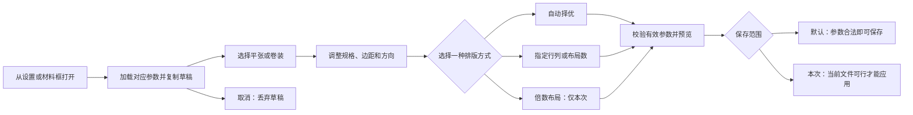

# Design

## Source of truth

- **状态：方案 A 已选定；原生共享编辑器已实现，保留后续实机验收事项。**
- **日期：2026-10-09。**
- **适用范围：**自动排版设置，以及材料选择框调用的本次排版参数编辑界面。其他工具页面不自动继承本文件的布局规则。
- **设计基准：**[方案 A HTML](docs/V5卷装参数与居中布局预览方案.html)，SHA-256：`B76A796DEB504BF34903D4BFAF1752A0A9705357B31E403E76A65E2FB5C4D011`。
- **审美修订：**依据[修改前评审报告](output/reviews/scheme-a/方案A_审美评审.html)调整比例、字号、选中态和辅助操作；历史报告及其截图保留为修改前证据。
- 用户已选择方案 A 作为实现依据。[方案 B](docs/V5自动排版_方案B_简化操作.html)保留用于比较，不纳入本次修改。
- 原生实现与验证见[交付说明](docs/方案A原生实现与验证.md)；HTML 是交互与视觉基准，原生界面使用 AntdUI。
- 本文件区分：**已确认规则**来自用户同一会话的要求；**当前事实**来自 HTML、截图和源码；**待落实要求**是后续实现和验收标准。不能将 HTML 演示当作原生程序已实现的功能。

已检查的证据：

| 编号 | 证据 | 可确认的事实 |
|---|---|---|
| E1 | [项目指南](AGENTS.md)、[README](README.md) | Windows Forms／.NET Framework 4.8，采用 AntdUI；产品服务印前生产与批量文件处理 |
| E2 | [设置界面数据读写](src/WindowsFormsApp3/Forms/Controls/Settings/SettingsImpositionControl.cs)、[设置界面控件](src/WindowsFormsApp3/Forms/Controls/Settings/SettingsImpositionControl.Designer.cs) | 平张、卷装各六项尺寸／边距参数；启用状态与行列设置共用；平张可从 PDF 获取纸张尺寸 |
| E3 | [方案 A](docs/V5卷装参数与居中布局预览方案.html)中的 `effectiveConfiguration`、`validateParameters`、`calculate`、`render`、保存事件 | 三种策略互斥；默认设置和本次应用分开；当前仅为页面内模拟 |
| E4 | [临时窗口](src/WindowsFormsApp3/Forms/Main/TemporaryImpositionParametersForm.cs)、[共享原生控件](src/WindowsFormsApp3/Forms/Controls/ImpositionParametersEditor.cs)、[参数模型](src/WindowsFormsApp3/Models/TemporaryImpositionParameters.cs) | 设置与本次入口共用控件；窗口可调整大小，按工作区限制；三种策略互斥，各材料保留独立已应用布局 |
| E5 | [排版服务](src/WindowsFormsApp3/Services/ImpositionService.cs)、[编辑器 Presenter](src/WindowsFormsApp3/Presenters/ImpositionEditorPresenter.cs) | 预览与生产共用有效参数及服务；卷装精确少行数由留白满足长度下限 |
| E6 | [800px 高指定布局](output/playwright/scheme-a-refined/1280x800-specified.png)、[900px 高指定布局](output/playwright/scheme-a-refined/1280x900-specified.png)、[倍数布局](output/playwright/scheme-a-refined/1280x800-multiple.png) | 修订后左参数右预览，辅助操作降权，选中态统一，摘要仍为两行 |
| E7 | [修订单屏检查脚本](.build-verify/check-refined-scheme-a.cjs)、[修订检查报告](.build-verify/scheme-a-refined-layout-report.json) | 15 个窗口尺寸、180 个状态的边界／溢出检查通过，无脚本异常；不等同于所有业务路径和可访问性均通过 |
| E8 | [截图与焦点检查脚本](.build-verify/capture-refined-scheme-a.cjs)、本次浏览器复核 | 原 25 个编辑窗口按钮保留但降低次级视觉权重；布局数 → 行列错误已修复，尺寸输入 Tab 顺序及两个对话框焦点返回检查通过 |
| E9 | [原生测试报告](.build-verify/TestResults/scheme-a-native.trx)、[原生桌面截图](output/native-scheme-a/native-1160x720.png)、[紧凑窗口截图](output/native-scheme-a/native-880x445.png) | 76 项原生功能、计算、材料选择与批量路径定向测试通过；5 组窗口的两种材料与三策略边界检查，以及警告、长卷局部导航验证 |

已查看界面截图、HTML 视觉变量与原生组件。未把仓库中的品牌探索图作为本界面的品牌定稿；尚无专门的原生共享编辑控件或覆盖完整交互的设计验收记录。

## Brand

**定位：**面向生产操作的专业桌面工具。界面语言应准确、稳定、紧凑，让操作者优先看到材料规格、当前规则和排版结果。

- 沿用 AntdUI 与现有浅色工作台的视觉语言。蓝色用于当前选择、可操作入口和主确认操作。
- 信任反馈依靠明确的文件来源、单位、保存范围、模式标签和参数校验。
- 不使用装饰性大卡片、连续动画或大面积高饱和背景占用预览空间。
- 主次操作必须有层级；低频恢复按钮不能与“应用本次参数”获得同等视觉权重。

## Product goals

**已确认目标：**

1. 同一套编辑界面服务“默认设置”和“本次参数”，分别加载与保存。
2. 参数在左侧，预览和结果在右侧；小窗口允许重新排列分组。
3. 参数、预览、结果及确认操作在目标可视范围内完整显示，不使用页面或参数区滚动条，也不能通过裁切内容实现无滚动。
4. 自动择优、指定布局、倍数布局互斥；仅当前方式参与计算，切换保留各自输入。
5. 平张检查纸张宽高；卷装仅受横向幅宽限制，纵向按行数自动延展，最小长度是下限。
6. 页序只负责复制页面；复制次数和排版倍数完全独立。
7. 预览纸张与网格居中，正常结果摘要紧凑；错误时才展开完整提示。

**范围边界：**按 A 实现原生设置和本次参数编辑、共用预览与计算规则，覆盖材料框及批量配置映射；不修改 B、不生成真实拼版 PDF、不引入新依赖或重做软件品牌。

**成功信号：**操作者能迅速识别保存范围和排版方式；没有固定行列与倍数同时生效的冲突；调整后预览和摘要一致；取消不改变已保存值；所有必要控件可见、可操作。

## Personas and jobs

| 角色 | 任务 | 需要的反馈 |
|---|---|---|
| 生产操作员（根据项目用途推断） | 为当前订单调整材料、边距、行列或倍数，核对排版后继续处理 | 当前文件尺寸、当前策略、每纸布局数、实际开料长度、明确的本次应用按钮 |
| 默认参数维护者（根据设置入口推断） | 配置后续任务的平张／卷装基准 | 默认值与预览样本分开；样本放不下不能阻止合法默认参数保存 |

共同场景是短时间、多次重复操作。数值、单位、规则和确认操作的重要性高于装饰和解释文字。

## Information architecture

### 产品入口与保存范围

| 项目 | 设置入口 | 材料选择框入口 |
|---|---|---|
| 标题 | 自动排版设置 | 本次排版参数 |
| 范围标记 | 默认设置 | 本次任务 |
| 成品尺寸 | 可输入预览尺寸或选择参考文件 | 读取当前任务，参数窗口内只读 |
| 排版方式 | 自动择优／指定行列 | 自动择优／指定行列或数量／倍数布局 |
| 倍数方式 | 显示“仅本次”并禁用 | 可选择 |
| 确认操作 | 保存默认设置 | 应用本次参数 |
| 影响范围 | 后续任务的基准 | 当前任务、当前材料的排版参数 |

### 方案 A 的界面层次

```text
窗口标题与范围标记                 平张／卷装切换
启用排版                         默认值／本次草稿说明
┌ 左侧：参数 ─────────────────┬ 右侧：预览 ─────────────────┐
│ 材料规格                    │ 当前排版方式标签            │
│ · 平张宽高／卷装幅宽与下限  │ 缩放／适应窗口／局部查看    │
│ · 四边距、单项恢复、纸张导入│ 真实比例的纸张与页面网格    │
│ 成品尺寸与文件来源          │ 长卷位置控制、图例          │
│ 页面方向                    │ 两行结果摘要                │
│ 排版方式及当前方式输入      │ 异常时展开的警示与修正      │
└────────────────────────────┴────────────────────────────┘
恢复默认／恢复自动              草稿状态、取消、保存／应用
```

顶部的“模拟打开入口／体验场景”和底部的“已应用参数反馈”是 HTML 的演示辅助，不默认迁入软件产品界面。参数与操作说明属于辅助对话框，不占据核心编辑区。

### 参数归属

| 参数组 | 参数 | 归属与说明 |
|---|---|---|
| 平张基准 | 纸张宽、高；上、下、左、右边距 | 独立于卷装保存和恢复 |
| 卷装基准 | 固定幅宽、最小长度；上、下、左、右边距 | 长度下限不作为固定纸高 |
| 共用基准 | 启用状态；默认行数、列数 | 当前设置界面共用一组默认行列；A 的默认策略随之共用 |
| 页面方向 | 自动方向、禁止旋转、固定 270° | 两种材料分别保留；独立于三种排版方式 |
| 本次操作 | 指定布局数、行／列倍数与 N | 不写入全局默认设置 |
| 成品来源 | 文件、参考页、尺寸来源、宽高 | 不得与纸张宽高混用；预览样本不作为默认纸张参数保存 |
| 排版结果 | 行列、布局数、角度、开料长度、四边留白 | 由当前有效参数推导，右侧只读 |

## Design principles

### 三种方式只允许一种生效

| 方式 | 左侧输入 | 有效计算参数 | 右侧反馈 |
|---|---|---|---|
| 自动择优 | 说明，不出现行列数值输入 | 行列自动、倍数关闭 | “自动择优”及计算结果 |
| 指定布局 | 按行列／按布局数二选一 | 固定值或目标数量，倍数关闭 | “指定 4×2”等标签 |
| 倍数布局 | 按行／按列、倍数 N | 行列自动，仅该方向满足倍数 | “行 3 倍数”等标签 |

- 指定行列至少固定一项，另一项可以自动；两项都自动时引导选择“自动择优”。
- 指定数量后提供可行网格组合，不能只修改布局数而不更新行列。
- 切换方式保留未使用的输入缓存，但计算、校验、保存有效值和脏状态判断都只考虑当前方式。
- 方式选择本身代表启用，不再增加独立的“开启倍数约束”开关。

### 预览、保存和应用分开

编辑草稿立即预览；只有确认才更新对应目标。全局保存检查材料参数是否合法，样本不适合属于预览警告。本次应用需要当前文件和布局可行，不可行时禁用确认。

### 排版与几何规则

- 先扣除四边距得到可印刷区域，再在该区域中居中放置网格；非对称边距不强求网格与整张纸的中心重合。
- 平张：网格宽、高均须不超过可印刷区域；不能强行增加一行或一列来满足倍数。
- 卷装：网格宽度须不超过幅宽减左右边距。实际开料长度采用 `max(最小长度, 上边距 + 行数 × 单页有效高度 + 下边距)`；不足部分留白，不额外复制页面。
- 卷装没有业务上的固定纵向上限；仍需要数值合法性和渲染资源保护。
- 页面方向改变有效单页宽高，不得改变三种方式的输入归属。
- 页序复制次数不参与行列、倍数或策略选择。

### 信息密度与操作层级

常用参数直接可见；解释放在短提示、标题提示或说明对话框。正常结果两行显示网格、布局数、角度、长度、四边留白和简短状态；不使用三层卡片重复表达同一结果。只有异常展开完整警示和可执行修正。

## Visual language

### 当前 A 的视觉变量（事实）

| 用途 | 当前值 |
|---|---|
| 主操作／选中蓝 | `--blue: #1264d6` |
| 主要文字 | `--ink: #26384d` |
| 次要文字 | `--muted: #566b82` |
| 分隔线 | `--line: #dbe4ef` |
| 浅蓝背景 | `--soft: #edf5ff` |
| 卷装长度强调 | `--roll: #956022` |
| 成功／错误 | `--green: #147962`、`--error: #ac5145` |

HTML 使用 Microsoft YaHei UI／Microsoft YaHei，数值使用 Consolas。宽桌面标题 16px、分组标题 13px、必要标签 12px、主要输入 14px、提示及单位 11px，结果主要值约 15px；紧凑窗口仍存在 10px 辅助文案。圆角主要为 3–6px，组间距通常 12px；阴影降到窗口轻微投影，选中控件统一浅蓝底与内描边。

### 待落实的视觉规则

- 主色只强调当前方式与确认操作；次级选择、恢复、说明和导入不与主操作争夺注意力。
- 生产界面以 12px 左右的主要文字和清晰数值为起点；必要参数标签不通过不断缩小字号来满足单屏要求。
- 输入标签、单位、状态标记分工明确；同一数值的单位不重复堆叠。
- 预览网格用淡蓝和细轮廓，材料／可印刷区域／网格可区分；图形辅助线不能遮挡结果。
- 正常结果摘要在已测 1280×900 状态约 61px；异常可扩展，不为提示预留永久大空白。
- 无持续动画；尺寸适配和选中反馈不改变焦点位置。
- 原生实现映射现有 AntdUI 主题与项目 SVG 资源，不另外建立一套互相冲突的设计系统。

## Components

| 组件 | 变体与状态 | 设计职责／现有基准 |
|---|---|---|
| 入口宿主 | 默认设置／本次参数 | 负责加载、保存目标、标题与取消；演示入口切换不是产品功能 |
| 材料切换 | 平张／卷装 | 切换对应规格和边距；不丢失另一组草稿 |
| 范围标记与来源标记 | 默认、本次、沿用默认、本次覆盖、未保存 | 明确作用范围，避免误以为已保存 |
| 单位数字输入 | 正数、非负边距、整数、只读、禁用、非法 | 宽高与单位配对，支持小数；行列和布局数使用整数 |
| 成品尺寸来源 | 预览参考／当前任务只读 | 显示文件与尺寸依据；与纸张导入分开 |
| 页面方向选择 | 自动、0°、270° | A 使用三按钮；各材料独立保留 |
| 排版方式选择 | 自动、指定、倍数；默认入口禁用倍数 | 三段同层级，选中态和 `aria-pressed` 一致 |
| 指定布局编辑器 | 行列／数量；单轴自动；可行组合 | 与倍数编辑器互斥；至少一项手动值 |
| 倍数编辑器 | 行／列、N | 无额外启用开关；只在本次模式可用 |
| 预览画布及工具 | 适应窗口、局部、缩放、位置控制 | 独立于参数；长卷保持真实尺寸信息 |
| 两行结果摘要 | 可用、停用、无结果、警告、错误 | 正常紧凑；异常展开文字和修正入口 |
| 操作栏 | 恢复默认、恢复自动、取消、保存／应用 | 确认唯一主色；取消不写入数据 |
| 辅助对话框 | PDF 纸张示例／参数说明 | 不占主编辑区；支持关闭和焦点返回 |

共享控件应由参数模型和宿主上下文驱动，不直接把全局 `AppSettings` 写入动作绑定在复用的 View 内。业务校验与布局计算复用 Presenter／Service；颜色、字体和间距继承现有主题约定。

**按钮密度事实：**默认卷装指定布局状态，A 主窗口有 25 个可见按钮。三种策略属于高频入口；单项恢复、对齐对比、缩放和说明属于次级或低频入口。该观察不自动授权将 A 改为 B。

## Accessibility

**目标：**必要参数能通过键盘完成编辑，焦点可见，标签与单位可辨识；状态不能只靠颜色传达。当前未完成完整可访问性审计。

- Tab 顺序按入口上下文、左侧参数分组、预览工具、底部操作排列；隐藏的非当前方式控件不得获得焦点。
- 模式按钮可使用键盘激活，选中状态与可访问名称一致；行列“自动”复选框与其输入关联。
- 对话框打开后移入焦点，Escape 取消，关闭后回到触发控件。
- 更新预览不抢夺正在输入的焦点；错误包含文字与修正方式，状态采用合适的公告机制。
- 主要小字号文字以至少 4.5:1 的对比度作为验收目标；禁用状态单独处理。
- 修改前的 `#1677ff` 与白色约 4.10:1，`#6e8095` 与白色约 4.05:1；本轮已加深为 `#1264d6` 与 `#566b82`。这不代表所有控件状态、字号和原生主题均已完成可访问性验证。
- 保留减少动态效果的系统偏好；不依赖悬停才能发现核心操作。

## Responsive behavior

**用户要求：**核心参数、预览、结果和确认按钮在可视范围内完整显示，无页面或参数区滚动；不能用 `overflow:hidden` 裁掉必需内容作为达成方式。

当前 A 的适配方式：

| 条件 | 布局 |
|---|---|
| 宽度 ≥1101px 且高度 ≥651px | 左侧 46% 参数、右侧 54% 预览，参数单列；高度 ≤780px 时收紧间距及控件尺寸 |
| 宽度 760–1100px 且高度 ≤850px，或桌面高度 ≤650px | 左侧约 60%，参数内部两列；右侧约 40%，保证必要字段容纳 |
| 宽度 760–1100px 且高度 >850px | 沿用左侧约 43%、右侧约 57%，参数单列 |
| 宽度 <760px | 上部参数分组、下部预览；预览图与摘要可并排 |
| 宽度 ≤560px | 重排字段和说明；不删除必需参数或确认操作 |

修订报告覆盖：1440×900、1280×900、1280×800、1280×781、1280×780、1280×760、1280×750、1280×720、1024×768、960×640、800×700、800×600、600×900、600×720、460×900。它们是已测样本，不是“任意小窗口均可容纳”的保证。

1280×800 指定卷装状态，参数末组下方空白从约 258px 降至 67px，预览栏从约 502px 扩至 677px；正常摘要保持 61px。高度断点、平张及错误态均包含在本轮检查中。

后续验收检查：页面与关键容器的滚动宽高、控件边界、分组互不遮挡、数值不被截断、标签可读、按钮可触达；同时检查系统缩放和实际原生窗口。长卷的位置滑条是画布导航控件，不是让参数区滚动。

原生采用宽窗口 46%／54%，宽度不足 1050 或可用高度不足 620 时参数内部双列；高度不足 500 时压紧窗口顶部。已验证 1160×720、1040×620、941×529、800×520、880×445；这些尺寸按当前显示环境验证，不代表所有显示器和 DPI 均已穷尽。

## Interaction states

### 主流程



### 状态与动作

| 状态 | 反馈 | 确认行为 |
|---|---|---|
| 加载／计算 | 正在读取或更新；保留用户输入，避免旧结果冒充最新结果 | 本次应用等待当前版本完成 |
| 自动择优 | 左侧说明，右侧计算值 | 使用自动有效参数 |
| 指定布局 | 对应输入和组合；另一种指定方式不同时生效 | 使用当前指定方式 |
| 倍数布局 | 方向与 N；标签显示当前倍数 | 忽略缓存的固定行列和目标数量 |
| 无当前文件 | 显示未取得成品尺寸，不伪装为真实文件 | 临时应用不可用；默认基础参数可独立编辑 |
| 非法基础参数 | 指出字段与原因，保留输入 | 保存／应用均不可用 |
| 默认预览不适合 | 警告“样本放不下，合法默认可保存” | 参数合法时仍可保存 |
| 本次布局不可行 | 宽度／纸张范围或数量组合原因；可切换自动方式 | 本次应用不可用 |
| 停用排版 | 保留草稿，预览和结果不冒充有效布局 | 保存停用状态，不影响页序复制 |
| 未保存／未应用 | 标记草稿状态和来源 | 只有确认才更新目标 |
| 成功 | 短提示及已保存／已应用反馈 | 不自动覆盖另一入口的草稿 |

### 恢复和取消

- **恢复默认参数：**本次入口恢复当前材料的默认规格、边距、方向和方式，清除本次倍数；设置入口撤销当前材料未保存修改。
- **恢复自动布局：**保留材料尺寸、边距和方向，切换自动择优；这是明确的恢复动作，可以清除指定值。
- **单项恢复：**只恢复所选分组；恢复行列同时恢复对应默认方式，避免固定方式下留下全部自动的无效状态。
- **取消：**放弃当前入口草稿，不修改默认设置或已应用本次参数。
- **应用本次参数：**只提交当前材料；另一材料未完成的草稿不阻塞当前材料应用。
- **窗口层级：**临时参数窗口跟随材料框的置顶状态；显示、激活和句柄重建后恢复在材料框前方。模态期间父窗保持不可操作，关闭后恢复父窗原操作状态和图钉偏好；更深层模态窗口保留在临时参数窗口前方。验证记录见[置顶遮挡修复](docs/方案A原生实现与验证.md#置顶遮挡修复2026-10-09)。
- 切换入口或材料时保留页面内草稿；跨窗口、跨任务及程序重启后的恢复策略见待确认事项。

### 已知缺口与验证边界

1. **A 的指定方式往返错误已修复。**`byGrid` 处理器改为读取 `strategy(s)`，不再访问其他函数的局部变量；输入布局数 6 后切回行列，仍保留 6 个布局。
2. 本轮将数量／行列往返加入 180 状态检查，并检查脚本异常。该验证覆盖本轮修改路径，不代表全部交互已经完成验收。
3. 原生两入口已共用 `ImpositionParametersEditor`；宿主分别处理默认保存与本次应用，HTML 演示入口和反馈条没有搬入生产窗口。
4. 原生已修改 `UseExactRows` 可行性与开料长度算法，手动少行数不再因未铺满最小长度而失败；旧 8 行／96 页限制已移除，数量按因子枚举。
5. 保留原有跨窗口尺寸／方向快照兼容，布局操作不写入下次默认；原生标签区分默认草稿、沿用默认与本次覆盖，各材料布局分别保留。
6. 原生已接入异步 PDF 分析及真实默认设置保存，已验证错误保留输入、较旧预览不覆盖最新结果、默认保存与本次应用隔离；系统文件选择对话框及全部 DPI 组合仍需人工实机验收。
7. 离线不应影响本地文件排版。未给出远程服务需求，不新增网络依赖或虚构网络状态。

## Content voice

- 使用简体中文，短句、具体原因和可执行动作。
- 固定术语：**默认设置／本次参数；自动择优／指定布局／倍数布局；纸张尺寸／成品尺寸；固定幅宽／最小开料长度／实际开料长度**。
- 页面方向的自动选择使用“自动方向”，避免与排版方式“自动择优”混淆。
- “保存默认设置”与“应用本次参数”必须体现不同写入目标，不统一成含义模糊的“确定”。
- 正常状态使用“布局可用／参数可保存／排版停用”，不重复讲解整个算法。
- 失败描述区分“平张宽高放不下”“卷装幅宽不足”“数量或倍数组合无解”和“输入非法”；不把卷装长度描述为超出固定范围。
- 单位紧随数值；摘要可用一次“留白(mm)”覆盖四边，不重复四个单位卡片。
- 示例明确标记“示例”，不使用真实文件已读取或真实设置已保存的措辞。

## Implementation constraints

- 原生技术约束：Windows Forms、.NET Framework 4.8、现有 AntdUI 控件与 SVG 图标；按项目 MVP 分工，View 转发交互，Presenter 负责协调与异常处理，Service 负责业务规则。
- 共享的是参数编辑与预览控件；默认设置宿主和临时对话框宿主分别拥有加载、提交和取消目标。复用控件不能隐式写全局设置。
- 真实预览与实际布局必须使用相同的有效参数和算法；不能在界面里再写一套独立生产排版逻辑。
- 新规则应覆盖材料框看板、批量文件列表、参数返回结果及后续处理；避免某处继续读取页序复制次数作为倍数。
- 已用显式策略状态表示三选一；原始输入缓存与有效参数分开，旧快照通过可空策略兼容，新编辑器输出有效策略参数。
- 全局选择自动时已显式保存行列为 0；默认方向分别保存。仅本次倍数和指定数量不进入默认设置。
- 输入和文件路径支持中文、小数及合理精度。UI I/O 异步执行，不使用 `.Result`／`.Wait()` 阻塞主线程。
- 预览采用矩形网格示意；长卷使用重复图案等有界渲染方式，不随行数创建大量控件或页面节点。适应窗口与局部查看只改变视图。
- 本轮修改原生控件、宿主、参数映射及相关服务和测试；保留 A 的按钮式方向与策略选择，没有将 B 的下拉方案迁入 A。

### 后续交接验收条件

- [x] 两入口标题、来源、确认文案及写入目标一致；取消无数据污染。
- [x] 三种方式互斥；方式切换和行列／数量往返均保留正确输入，无脚本异常。
- [x] 全局禁用倍数与指定数量；本次保存不回写默认值。
- [x] 平张检查宽高；卷装长卷可延展，少行数可用留白满足最小长度。
- [x] 原生预览、看板、批量结果使用同一有效参数与生产服务；HTML 仍为独立演示。
- [ ] 全部必要输入、标签、单位和按钮在目标窗口与 DPI 下可见；不滚动、不裁切、不互相遮挡。
- [x] 正常摘要保持紧凑；已测窗口中的警告／错误展开后仍满足单屏显示。
- [ ] 键盘、焦点、主要文字对比度及读取／计算／保存失败路径完成验证。

本轮以原生 AntdUI 控件落实 A 的结构和交互，并检查真实原生截图；不宣称跨 HTML 与 WinForms 的像素级一致。

## Open questions

- [x] **最终方案已选 A。**用户已要求按 A 实现；B 保留作为历史备选。
- [ ] **生产环境最小窗口和系统缩放范围？**负责人：用户／产品负责人。原生已验证 5 组窗口，仍需覆盖实际多显示器及 DPI。
- [ ] **全局行列／方式继续共用，还是按平张、卷装独立保存？**负责人：用户／产品负责人。影响：数据结构与旧设置迁移；当前 A 沿用共用语义。
- [ ] **倍数 N 是否确有 2–16 的业务上限？**负责人：用户／产品负责人。影响：校验与输入控件。该范围目前只是原型／现有实现限制，不能当作卷装长度上限。
- [ ] **本次尺寸和方向是否允许跨弹窗或重启记住？**负责人：用户／产品负责人。影响：旧快照恢复与“默认／本次”来源标签。当前只确认不写全局默认。
- [x] **A 的布局方式往返错误已修复。**HTML 与原生数量／行列往返均已验证。
- [x] **原生卷装长度下限规则与共享界面已同步实现。**有界长卷渲染、服务计算和几何居中均有定向验证。
- [ ] **小字号对比度与高密度布局如何共同达标？**负责人：设计／实现者。影响：主题映射和字号，需要实际界面验证，不以单纯无溢出代替可读性。
